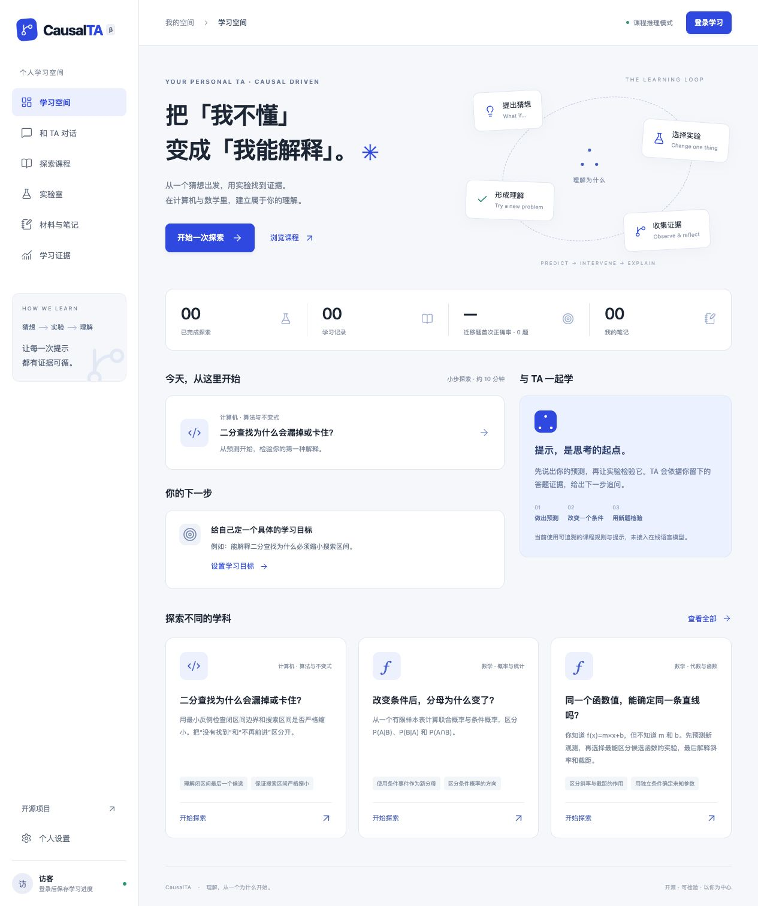

# CausalTA

**Your Personal TA — Causal Driven.**

[](https://github.com/JayLZhou/causal-ta/actions/workflows/tests.yml)

CausalTA 是一个因果驱动的个人学习助教项目，面向用户自己创建的任意学科课程：从你的卡点出发，通过诊断问题区分可能原因，选择一个适量的提示或实验，再用新题检查你能否独立运用。

个人 TA 围绕你的课程、材料和持续学习证据工作。**Web 0.9 alpha 源码**新增任意学科课程、PDF/Word/文本导入、可选图片识别、段落检索 RAG、可查看编辑的课程 Memory、模型连接及独立复测。六个原创 CS/数学模块保留为可自动检查的示例。**本次公开站尚未更新**：Sites 源码服务返回 HTTP 500；线上仍为上一版。真实模型辅导和图片识别需要有效模型凭据，尚未完成真实 API 质量验收。**Python 0.6 alpha** 保留本机引擎、教师工作台和研究工具。

“因果驱动”意味着检查竞争解释、区分观测与干预，并验证帮助之后的独立表现；它不是把知识图谱或一次答错直接当成因果证据。详见 [个人 TA 产品方向](docs/PERSONAL_TA.md) 与 [因果设计](docs/CAUSAL_DESIGN.md)。

## 网页与源码

**[打开在线 CausalTA](https://causal-ta-jaylzhou.berry-elm-9957.chatgpt.site)** · 公开课程首页，登录后保存个人练习与笔记。

完整 Web 应用位于 [`web/`](web/)，含前端、API、数据库迁移、模型适配器和测试。开发运行见 [Web README](web/README.md)，交付范围见 [Web 验证记录](docs/WEB_RELEASE.md)。

## 运行完整 Web

```bash
git clone https://github.com/JayLZhou/causal-ta.git
cd causal-ta/web
npm ci
npm run setup
npm run dev
```

需要 Node.js 22.13+；本地登录使用测试身份。新版本功能与验收边界见 [0.9 交付记录](docs/WEB_09.md)。

## 本机离线体验

离线体验需要 Python 3.11+ 和现代浏览器，无第三方运行依赖、API key 或模型下载。

```bash
git clone https://github.com/JayLZhou/causal-ta.git
cd causal-ta
python3 -m causal_ta.server
```

从本目录运行后打开 [本地页面](http://127.0.0.1:8765/)。也可指定端口：

```bash
python3 -m causal_ta.server --port 8766
python3 -m causal_ta.validate
python3 -m unittest discover -s tests -v
```

也提供 wheel 安装包，安装后使用 `causal-ta` 启动，资源不依赖源码目录。详见 [安装与迁移](docs/INSTALL.md)。包尚未上传 PyPI，请使用本地 wheel 文件，不要将同名远端包当成已验证的官方发布。

1. 选择一个计算机或数学课程模块。
2. 用理解检查区分自己的想法；答错后会优先出现对应的追问。
3. 观察初始现象，选择实验，先提交预测；可向 TA 请求提示。
4. 检查实验结果与剩余解释，区分观测和参数干预，再提交原始状态的解释。
5. 独立回答两道迁移题；此时暂停 TA 和理解检查，分别记录练习与迁移成绩。

源码模式的学习会话保存在 `.data/sessions.sqlite3`，wheel 安装默认使用 `~/.causal-ta/`；可用 `--data-dir` 或 `CAUSALTA_DATA_DIR` 指定目录。浏览器只保存当前会话 token，刷新或重启后可恢复。新会话固定完整课程快照与 SHA-256 版本，后续课程修改不会改变其题目和评分。0.1 的旧会话没有原始快照，显示“来源未核验”，建议重新开始。导出不包含会话 token，但可能包含学生自由文字，分享前应检查个人信息。

## 教师创建课程

```bash
python3 -m causal_ta.server --authoring
```

打开 [教师工作台](http://127.0.0.1:8765/teach)，复制模板，修改课程 ID、问题和反馈，校验后保存。新课程立即出现在学习入口，无需重启。完整 JSON 可下载；变量、实验和误解映射可在高级编辑区修改。每次修改后需重新校验，同名课程不会被覆盖。

自定义课程保存在数据目录的 `courses/` 下，源码默认 `.data/courses/`，与内置课程分开；默认学习模式也能加载已保存课程，但禁止作者接口。详见 [课程作者指南](docs/COURSE_AUTHORING.md)。

## 可选：启用自然语言 TA

默认离线模式使用课程预设追问，不理解自由文字。已接入 OpenAI Responses API：配置 `OPENAI_API_KEY` 与 `CAUSALTA_MODEL`（有访问权限且支持 Structured Outputs 的模型 ID），然后运行：

```bash
python3 -m causal_ta.server --tutor openai
```

学生在页面主动勾选联网 TA 后，才会发送本次消息、近期对话与学习证据至 OpenAI。未勾选时仍完全离线。每会话最多 20 轮对话，单次输出上限 1200 tokens，网络调用超时为 20 秒；失败或无效引用会回退到预设追问。联网对话可能产生 API 费用。

模型仅返回文字与课程引用，没有工具、数据库访问或评分权限；它仍可能提供错误或过度具体的提示，需要教师审核。目前通过模拟响应验证接口，**尚未进行真实 API 和教学质量验证**。配置细节见 [TA 接入说明](docs/TUTOR.md)。

## 界面预览



## 可复查的策略对照

0.4 增加“诊断后追问”和“固定顺序”两种策略，每道理解检查记录选择理由、当时可选题目与先前证据。普通学习默认使用诊断策略，不随机分组。

可选本机研究模式在参与者阅读说明并同意后，按参与码一次性随机分组。固定课程快照，同一码恢复原进度，研究会话只使用离线 TA。报告包括未完成和退出的分母，区分完成者差值与缺失结果的可能范围。它尚未证明学习效果，也不是公网课堂平台。

```bash
python3 tools/demo_study.py
```

该命令只运行合成数据的软件演练，见 [研究工具指南](docs/STUDIES.md)。真实使用仍需研究负责人完善方案和参与说明。界面支持删除本次记录；研究退出后保留最小分组与退出计数以报告缺失结果，具体保留字段见指南。

## 已实现与边界

| 能力 | 当前状态 |
|---|---|
| 跨学科课程包 | 已实现；6 个原创模块，共用同一个引擎 |
| 可解释的实验推荐 | 已实现；有限候选空间中的期望信息增益 |
| 观测 / 干预 / 数学变换 | 已区分语义；每次实验重置到原状态 |
| 预测、解释、独立迁移 | 已实现；迁移题仅记录本会话首次回答 |
| 会话保存、恢复、导出 | 本机 SQLite；Web 登录账户隔离的云端 D1 |
| 个人材料与跨会话证据 | Web 支持概念分组、不同情境与间隔复习；本人核查与自动判分分开 |
| 自带题目探究 | 题目与尝试 → 两种解释 → 锁定预测 → 观测 → 新题首次作答 → 核查 → 复习 |
| 自由语言 Socratic 对话 | 可选 OpenAI 接口已实现，模拟协议测试通过；真实模型质量待验证 |
| TA 评测 | 六门课程共 24 个合成场景；离线工程检查通过，18 条语义审阅待教师完成 |
| 教师编辑器 | 已实现本机复制、引导编辑、完整 JSON、校验、保存与下载 |
| 个人材料导入 | Web 0.9 支持 PDF、DOCX、TXT/MD/CSV；图片模型识别接口已接入、真实 OCR 质量未验证 |
| 课程 RAG | 持久化分段、中英文 BM25、账户/课程/勾选资料隔离、页码与引用快照；未接入向量检索 |
| 课程 Memory | 主动记录、待验证假设、复测自评分开存储；相关召回、编辑、删除；不宣称已掌握 |
| 学生误概念假设与追问 | 已实现规则式证据记录、针对性检查；未校准能力概率或验证诊断准确性 |
| 课程验证与版本固定 | 已实现只读检查命令和新会话课程快照 |
| 教学策略对照工具 | 已实现可选分组、同意、恢复、退出、完整分母汇总；仅合成演练验证 |
| 安装与发布构建 | wheel、源码发行包、独立 zip；本机干净环境安装验证；跨平台 CI 见状态徽章 |
| 键盘与窄屏流程 | 已修复反馈与阶段焦点，完成 320 像素视口演练；真实读屏与触摸待验证 |
| 程序与数学检查器 | 内置循环、二分查找及算术表达式；不执行用户代码、不检查开放证明 |
| 学习效果的因果估计 | 待收集随机化教学数据；当前没有效果结论 |
| 公网个人学习空间 | Web 已公开部署；Python 服务仍仅绑定 loopback；班级管理待实现 |

**可以创建任意学科课程并上传材料，不代表各学科都有经过验证的自动评分或教学质量。** 当前数学模块验证函数依赖与参数辨识，不把数学逻辑关系包装成真实世界因果关系。

## 项目结构

```text
web/                     云端个人空间、Worker API、D1、模型对话与测试
causal_ta/engine.py       有限模型、候选更新、信息增益、学习状态机
causal_ta/domain.py       内置循环、二分查找与数学表达式检查器
causal_ta/library.py      教师课程库与原子保存
causal_ta/study.py        策略研究协议、参与码、随机分配与汇总 CLI
causal_ta/learning.py     学习目标、误概念线索、形成性检查与证据记录
causal_ta/tutor.py        离线追问 / 可选 OpenAI 对话，与评分隔离
causal_ta/validate.py     课程作者的只读格式与可辨识性检查
causal_ta/server.py       本机 HTTP API 与 SQLite 会话
causal_ta/static/         中文学习界面
causal_ta/coursepacks/    随包分发的原创课程包
tests/                   模型性质与 HTTP 流程测试
docs/PROJECT_SPEC.md      产品定位、架构和发布验收
docs/CAUSAL_DESIGN.md     因果语义、识别边界和评估计划
docs/COURSE_AUTHORING.md  课程接入规范
docs/RESEARCH.md          已核实的相关工作与场景依据
docs/INSTALL.md           源码 / wheel 安装、数据目录与迁移
docs/RELEASE.md           构建、验证与公开发布前待办
docs/EVALUATION.md        固定场景评测、请求次数预算与教师审阅表
docs/ACCESSIBILITY.md     键盘使用方式、窄屏检查范围与未验证项
```

## 为什么值得做

项目拟聚焦可复现的教学诊断过程：每个问题为什么被选中、证据支持哪些解释、什么新任务能够检查迁移。这是一项需要验证的产品假设，并非已确立的新颖性或学习效果。

已有 [OATutor](https://github.com/CAHLR/OATutor) 提供提示、自适应选题与 BKT。CausalTA 的后续研究应与这些能力及普通 LLM tutor 正面对比，不能仅凭“有知识图谱”宣称创新。

## 开源与贡献

代码和本项目原创示例采用 MIT License。第三方参考链接的内容不包含在此许可证中；见 [来源说明](docs/RESEARCH.md)。欢迎首先贡献有误概念、可检查反馈和迁移题的课程模块，见 [贡献说明](CONTRIBUTING.md)。

1000 GitHub stars 是社区增长愿景。发布里程碑优先关注可运行性、真实课程使用、教师复用和持续贡献；公开源码仓库为 [JayLZhou/causal-ta](https://github.com/JayLZhou/causal-ta)。

执行 `python3 tools/export_release.py` 生成排除会话数据的独立源码包；标准 wheel / sdist 构建见 [发布指南](docs/RELEASE.md)。验证细节见 [验证记录](docs/VALIDATION.md)。

运行 `python3 tools/evaluate_tutor.py --output .data/evaluations/offline-01.json` 可复现离线 TA 场景评测。真实模型评测需显式启用并设置请求次数上限，见 [TA 评测指南](docs/EVALUATION.md)。

0.6 发布候选包含上述工具和键盘交互修复，详见 [本版说明](docs/RELEASE_0.6.md)。发行包目前仍为本地构建产物；真实模型与教学试用尚待完成。
